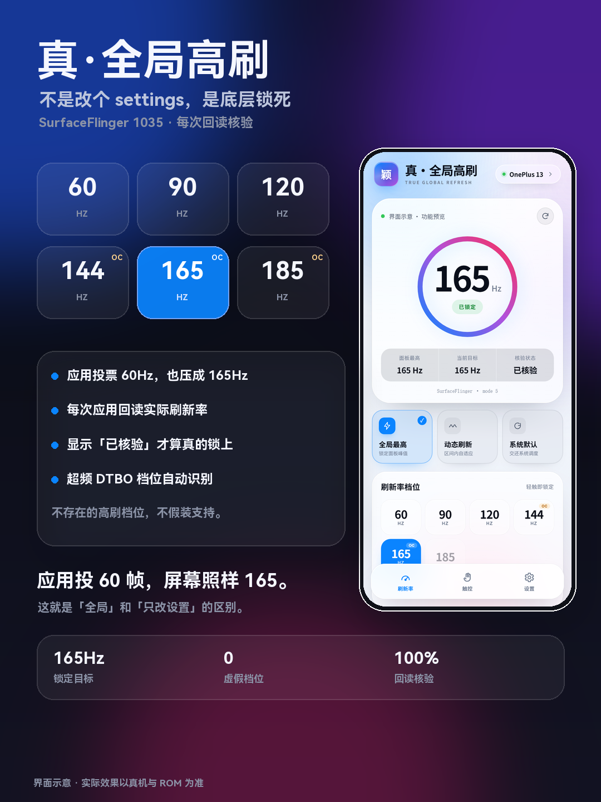
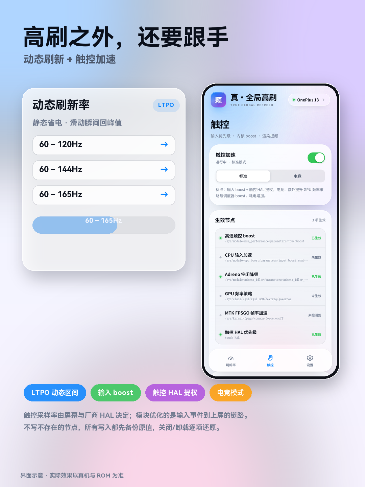
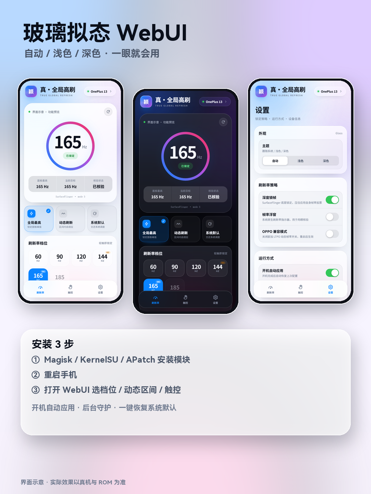

<p align="center">
  
</p>

<h1 align="center">真·全局高刷</h1>

<p align="center">
  小米 / OPPO / 一加 全平台 · 60–185Hz · 动态刷新率 · 触控增强 · 玻璃拟态 WebUI
</p>

<p align="center">
  
  
  
  
  
</p>

<p align="center">
  <a href="docs/assets/global-hfr.zip"><b>⬇ 下载模块</b></a>
  &nbsp;·&nbsp;
  <a href="https://wy15623505520-droid.github.io/global-hfr/">项目主页</a>
  &nbsp;·&nbsp;
  <a href="https://github.com/wy15623505520-droid/global-hfr/releases/latest">Releases</a>
</p>

---

## 这是什么

**真·全局高刷** 是一个面向小米 / OPPO / 一加（含 realme）的 Root 模块，用三层机制实现真正的全局刷新率控制，并附带触控加速与玻璃拟态 WebUI。

它不是“只写一个 `peak_refresh_rate` 就自称全局”的模块。

| 层级 | 手段 | 作用 |
| --- | --- | --- |
| ① 框架层 | `peak_refresh_rate` / `min_refresh_rate`，小米 / 澎湃额外写 `user_refresh_rate` | 设置刷新率上下限，兼容各家 ROM |
| ② 底层锁 | `service call SurfaceFlinger 1035 <modeId>` | 调用 AOSP `setActiveModeFromBackdoor`，把显示模式钉死，并让后续 DisplayManager / 应用帧率请求失效 |
| ③ 回读核验 | 读 `dumpsys display` 的实际刷新率与 active mode | 未达目标就重试；仍失败显示「待核验」，不假装成功 |

动态模式则相反：先解除底层锁，再把上下限交还 LTPO，让面板在区间内自适应。

---

## 功能

- **固定档位**：60 / 90 / 120 / 144 / 165 / 185Hz，自动扫描设备真实显示模式（含超频 DTBO）
- **动态刷新**：60–120 / 60–144 / 60–165 / 30–120 / 10–120
- **底层锁帧**：SurfaceFlinger 1035 + 回读核验，压住应用帧率投票
- **触控加速**：高通 `touchboost`、`input_boost`、MTK `fpsgo`、Adreno idler、触控 HAL 提权
- **电竞模式**：额外 GPU 频率策略 + 调度 boost
- **WebUI**：玻璃拟态，自动 / 浅色 / 深色；实时状态、节点列表、日志、扫描、恢复
- **守护**：开机自启、息屏亮屏重锁、刷新率漂移检测
- **恢复**：所有触控节点写前备份，关闭或卸载逐项还原

> 144 / 165 / 185Hz 需要屏幕或超频 DTBO 本身支持。不存在的档位 UI 会置灰，模块不会假装支持。

---

## 截图

| 封面 | 刷新率 |
| --- | --- |
|  |  |

| 动态与触控 | WebUI 与安装 |
| --- | --- |
|  |  |

> 截图为界面示意，实际效果以真机与 ROM 为准。

---

## 安装

1. 下载 [`global-hfr.zip`](docs/assets/global-hfr.zip)；
2. 在 **Magisk / KernelSU / APatch** 管理器中选择「从本地安装」；
3. 重启手机；
4. 打开 WebUI 调整档位 / 动态区间 / 触控。

**WebUI 入口**

- KernelSU / APatch：模块卡片 → 打开 / WebUI
- Magisk：安装 [KsuWebUI](https://github.com/5ec1cff/KsuWebUIStandalone) 之类的 WebUI 宿主，授予 Root 后打开

> 不要与其他「高刷 / 刷新率 / LTPO / VRR / dfps / Astra」类模块同时启用，会互相抢显示策略。

---

## 兼容性

| 系统 | 支持情况 |
| --- | --- |
| 小米 / Redmi / POCO（HyperOS / MIUI） | ✅ 支持 |
| OPPO / 一加 / realme（ColorOS / OxygenOS / realme UI） | ✅ 支持 |
| Android 11 及以上 | ✅ 支持 |
| Magisk / KernelSU / APatch | ✅ 支持 |
| 其他品牌 | ⚠️ 通用接口可装，但未专门适配 |

---

## 常见问题

**Q：为什么 144 / 165 / 185Hz 是灰的？**  
模块只能锁定设备真实存在的显示模式。面板原生 120Hz 不会凭空出现 144/165/185；刷了超频 DTBO 并被扫描到，才会出现并标注 OC。

**Q：显示「已锁定」但个别 App 还是 60Hz？**  
先开「帧率浮窗」看系统实际输出。若浮窗是 120/165 但画面仍卡，是 App 自身渲染限制（如 24/30fps 视频），不是刷新率没锁。

**Q：动态区间静止时掉到很低，正常吗？**  
正常。把下限设为 10/30 时，LTPO 在静态画面会进入低刷新率省电；希望静止也保持 60，把下限设为 60。

**Q：触控采样率会变高吗？**  
模块不会修改触控 IC 固件，也不谎称提升采样率。它优化的是输入 boost、触控 HAL 优先级、GPU 与调度策略，缩短「触摸 → 渲染 → 上屏」链路。

**Q：耗电会不会变高？**  
固定 165/185Hz 全程锁死必然更耗电。日常建议动态区间或 120Hz。

**Q：出问题怎么恢复？**  
WebUI → 设置 → 恢复系统默认；或在管理器卸载模块并重启。

---

## 项目结构

```text
.
├── module/                 # 模块源码（module.prop / hfr.sh / WebUI）
├── screenshots/            # 模块截图
├── docs/                   # GitHub Pages 主页
│   ├── index.html
│   ├── style.css
│   ├── app.js
│   └── assets/             # 截图与下载包
├── .github/workflows/      # 打 tag 自动发 Release
├── update.json             # 自动生成，无需手改
├── profile-README.md       # GitHub 个人主页模板
└── PUSH.md                 # 上传与发布步骤
```

## 本地打包

```bash
cd module
zip -r ../global-hfr.zip .
```


---

## 发版（自动）

1. 修改 `module/module.prop` 的 `version` 与 `versionCode`；
2. 提交并推送 `main`；
3. 打一个和 `version` 完全一致的 tag：

```bash
git tag v1.2.1
git push origin v1.2.1
```

GitHub Actions 会自动打包、创建 Release、更新 `update.json` 和 `docs/assets/global-hfr.zip`，并触发 Pages 构建。之后已安装的旧版本会按 `versionCode` 检查更新。

## 作者

**颖哥** · Android 玩机 / 模块开发

- 项目主页：`https://wy15623505520-droid.github.io/global-hfr/`
- GitHub：`https://github.com/wy15623505520-droid`

## License

[MIT](LICENSE) © 2026 颖哥

> 非官方模块，与小米 / OPPO / 一加无隶属关系。刷机有风险，请先备份并确保具备救砖能力。
