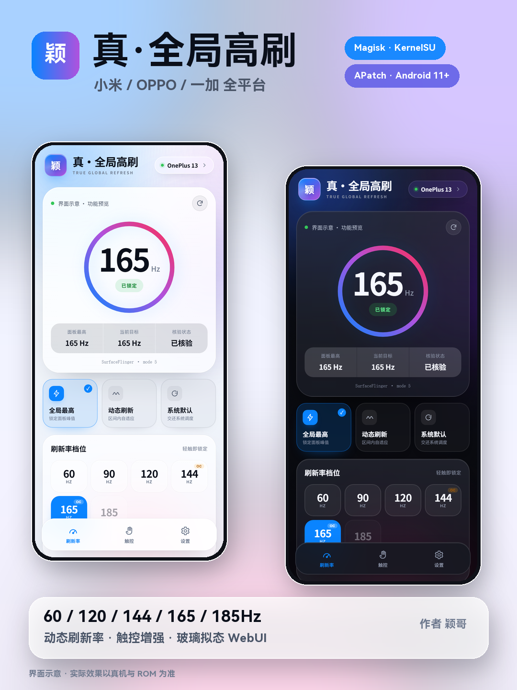

<p align="center">
  
</p>

<h1 align="center">真·全局高刷 v2.2.1</h1>

<p align="center">
  小米 / OPPO / 一加 / realme 与通用骁龙 · 天玑机型<br>
  动态下限 30 / 60 / 90Hz · 能力自检 + 多级回退 · 60–185Hz 固定档位 · 原生 / 自适应动态刷新率 · 触控增强 · 玻璃拟态 WebUI
</p>

<p align="center">
  
  
  
  
  
</p>

<p align="center">
  <a href="docs/assets/真·全局高刷.zip"><b>⬇ 下载模块</b></a>
  &nbsp;·&nbsp;
  <a href="https://yingge-dev.github.io/global-hfr/">项目主页</a>
  &nbsp;·&nbsp;
  <a href="https://github.com/yingge-dev/global-hfr/releases/latest">Releases</a>
  &nbsp;·&nbsp;
  <a href="CHANGELOG.md">更新日志</a>
</p>

---

## v2.2.1 更新了什么

真实性清理，不改变动态下限识别：

- 移除触控采样率写入：节点只可写不可回读，无法确认生效，旧 `sampling` 配置会被忽略。
- 小米底层锁固定档增加回读核验；确认不到显示「未确认」。
- 没有 SurfaceFlinger 底层锁的机型隐藏「深度锁帧」开关。
- 清理 sampling 相关状态字段、切换入口与备份逻辑。

## v2.2.0 更新了什么

这次只动动态刷新率，全局固定档保持 v2.1 逻辑。

- **动态下限支持 30 / 60 / 90Hz**：读取系统上报的 `mSupportedRefreshRates`，面板真的支持 30Hz 才显示 30，未上报就隐藏，不写无效档位。
- **新增 30 起步预设**：30–60 / 30–90 / 30–120 / 30–144 / 30–165 / 30–185，按面板上限自动过滤；60 / 90 / 120 起步的区间继续保留。
- **30Hz 自动走设置引擎**：没有 30Hz 显示模式但系统支持 30 下限的机型，自适应用 `min_refresh_rate` 切换，不强行调不存在的 1035 档位。
- **界面更紧凑**：下限 / 上限按真实速率生成，预设控制在两行内，点击仍然即点即用。
- **系统上限提示**：设置型自适应如果受系统 120Hz 上限限制，会明确显示实际区间，不假装能到 165。

## v2.1.0 更新了什么

这次解决“只能在一台手机上用”：

- **能力自检**：启动时检测 SurfaceFlinger 底层锁、DisplayManager `cmd display`、厂商刷新率键、系统原生上限；WebUI 设置页可随时重新自检。
- **固定档三级回退**：Settings → DisplayManager → SurfaceFlinger。每一步回读实际刷新率，全部失败就显示「兼容模式」，不假装锁定。
- **通用自适应**：没有 1035 底层锁的机型，自适应改用 `min_refresh_rate` / `peak_refresh_rate` 切换，触控升上限、静止回下限。
- **厂商键自动发现**：HyperOS 的 `miui_refresh_rate`，OPPO / 一加 / realme 的厂商键，存在才写入，写前备份；不存在就只用标准键。
- **非小米不再误用 1035**：底层锁只在能力检测通过时启用，避免在别的系统上调用错误接口。
- **按系统上限推荐**：原生动态跑不满面板时，自动推荐自适应。
- **项目主页**：新增版本发布横幅、更新日志和 GitHub 新版本提示。

> 其他品牌 / 系统：Android 11+ 且保留标准 DisplayManager / Settings 接口的机型，至少可以解锁档位与动态；能否锁死取决于 ROM 是否接受这些接口。自检页会直接列出本机支持情况。

## v2.0.0 更新了什么

这次修的是动态刷新率的根因：

- **静态画面不降 60**：旧版只写 `peak_refresh_rate` / `min_refresh_rate`，HyperOS 还有独立的 secure `miui_refresh_rate` 在起作用；v2 同时写入三者，静止可以正常回到下限。
- **切回动态仍被锁高刷**：`service call SurfaceFlinger 1035` 的底层锁会残留，v2 自动识别并切到自适应引擎，立即生效；手动切原生会明确提示重启，不再假装成功。
- **60–165Hz 动态不可用**：部分 HyperOS 把 144 / 165Hz 当底层增强档，系统原生动态上限只有 120Hz；v2 的自适应引擎直接切底层模式，60 / 120 / 144 / 165 全档可用。
- **WebUI 延迟大**：状态接口从每次 `dumpsys` 改为缓存文件 + shell 内置解析，实测 `status` 1.5s → 0.15s，切换 0.2–0.3s。
- **按机型识别**：新增系统原生上限 `mLockedMaxRefreshRate`、厂商 / ROM / 面板档位识别；非小米机型走 `cmd display` / Settings 通用回退。
- **更新提示**：模块管理器通过 `updateJson` 显示更新角标；新版 WebUI 打开时也会检查 GitHub，并展示更新日志。

完整记录见 [CHANGELOG.md](CHANGELOG.md)。

---

## 两种动态刷新率

| 引擎 | 行为 | 适合 |
| --- | --- | --- |
| **原生** | 写回 `min` / `peak`（小米额外写 `miui_refresh_rate`），由系统按画面内容调度；静止 60，滑动升到系统允许的上限 | 日常省电，60–120Hz |
| **自适应（底层）** | 小米 / HyperOS：用 SurfaceFlinger 1035 切模式，触控升上限、静止 3 秒回下限；可绕过系统 120Hz 上限 | 想要 60–165Hz 动态、或从小米固定档切回来 |
| **自适应（设置）** | 无 1035 的机型：用 `min_refresh_rate` / `peak_refresh_rate` 切换，触控时 min=peak=上限，静止时 min=下限 | 其他系统 / 品牌 |

WebUI 里可选「自动 / 原生 / 自适应」，自动会按机型、能力与系统上限选择。动态下限支持 30 / 60 / 90Hz，但只显示面板真实上报的档位；自适应每秒读取一次电源状态，耗电略高于原生。

> 已知限制：部分 HyperOS 的 144 / 165Hz 属于底层增强档，系统原生动态最高 120Hz；需要 165Hz 动态请选「自适应」，需要全程锁死请选「全局最高」。

---

## 功能

- **固定档位**：60 / 90 / 120 / 144 / 165 / 185Hz，自动扫描真实显示模式（含超频 DTBO）
- **动态刷新**：30–60 / 30–90 / 30–120 / 30–144 / 30–165 / 30–185，以及 60 / 90 / 120 起步区间，按面板真实档位生成
- **能力自检**：检测底层锁 / DisplayManager / 厂商键 / 系统上限，WebUI 直接显示可用接口
- **多级回退**：Settings → DisplayManager → SurfaceFlinger，失败标「兼容模式」
- **底层锁帧**：仅在能力检测通过时调用 SurfaceFlinger 1035，避免误用
- **触控加速**：高通 `touchboost`、`input_boost`、MTK `fpsgo`、Adreno idler、触控 HAL 提权
- **电竞模式**：额外 GPU 频率策略 + 调度 boost
- **WebUI**：玻璃拟态，自动 / 浅色 / 深色；实时状态、兼容性自检、节点列表、日志、扫描、恢复、更新检查
- **守护**：开机自启、息屏亮屏重锁、动态区间维持
- **恢复**：所有触控节点写前备份，关闭或卸载逐项还原

> 144 / 165 / 185Hz 需要屏幕或超频 DTBO 本身支持。不存在的档位 UI 会置灰，模块不会假装支持。

---

## 安装

1. 下载 [`真·全局高刷.zip`](docs/assets/真·全局高刷.zip)；
2. 在 **Magisk / KernelSU / APatch** 管理器中选择「从本地安装」；
3. 重启手机；
4. 打开 WebUI 选择固定档位或动态区间 / 触控。

首次开机会自动应用 `60Hz – 面板最高` 的原生 / 自适应动态；想全程满帧再切「全局最高」。

---

## WebUI

- KernelSU / APatch：模块页直接打开；
- Magisk：安装 **KsuWebUI** 并授予 Root，再打开模块 WebUI；
- 浏览器预览：直接打开 `webroot/index.html` 会显示演示数据，不会修改系统。

---

## 兼容与风险

- 支持 Android 11+；小米 / Redmi / POCO、OPPO / 一加 / realme 优先适配，其他品牌走标准 DisplayManager / Settings 接口。
- 具体能用到哪一步由 ROM 决定：WebUI → 设置 → 兼容性自检会列出本机可用接口；不支持的接口会明确显示，不会假装成功。
- 与 dfps、Astra 等其他刷新率模块冲突，请只保留一个。
- 修改系统显示策略存在兼容性风险；出现闪屏、黑屏或异常耗电，请点「恢复系统默认」并重启。

---

## 目录

```
module/          模块本体（打包进 zip）
  hfr.sh         核心引擎
  customize.sh   安装脚本
  service.sh     开机守护
  webroot/       WebUI
docs/            GitHub Pages 项目主页
update.json      模块管理器更新清单
```

## License

MIT © 颖哥
